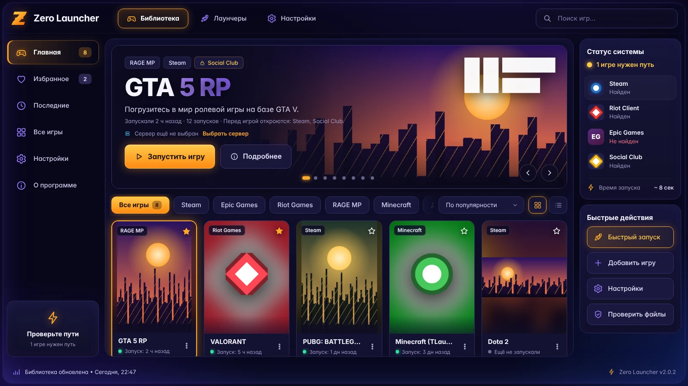
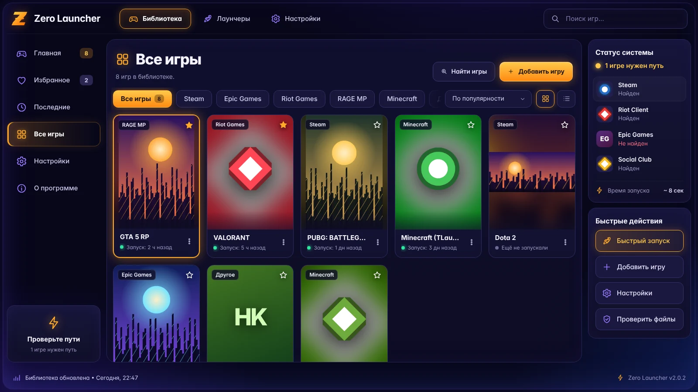
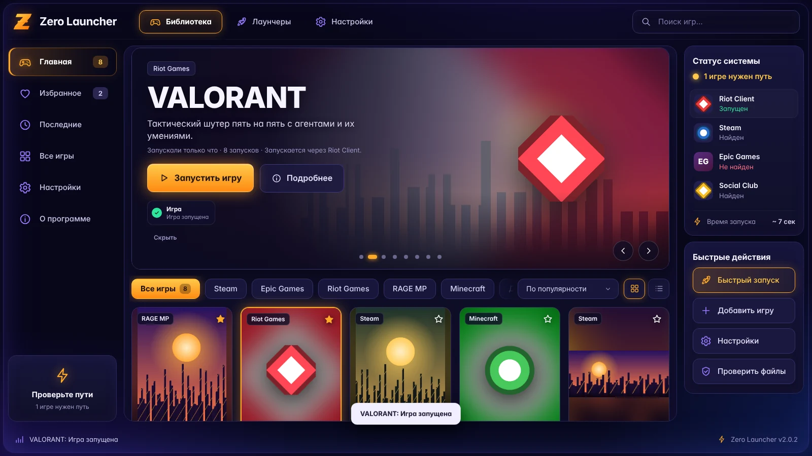

# Zero Launcher

[](https://github.com/kirill2008/zero-launcher/releases/latest)
[](https://github.com/kirill2008/zero-launcher/actions/workflows/test.yml)

[](LICENSE)

**[⬇ Скачать ZeroLauncher.exe](https://github.com/kirill2008/zero-launcher/releases/latest)**



Все игры в одном окне, запуск одной кнопкой. Перед онлайн-игрой Zero Launcher сам открывает нужные лаунчеры (Steam, Epic Games, Riot, EA, Ubisoft, Battle.net), ждёт, пока они загрузятся, и запускает игру. Для любой GTA всегда открывается Social Club.

В версии 2.0 новый интерфейс и автоматические обложки. В 2.0.1 добавлены иконки для Minecraft из Microsoft Store, ярлыков и игр Xbox, поиск игр EA app, Battle.net и Xbox, а также исправлено листание на главной. В 2.0.2 VALORANT и League of Legends запускаются, даже если Riot Client сам игру не начинает, и учтены правки по итогам проверки кода. Обложки, фоны и иконки игр подбираются сами и обновляются, когда их меняет игра или лаунчер.

## Как запустить

1. Скачайте `ZeroLauncher.exe` со страницы [Releases](https://github.com/kirill2008/zero-launcher/releases/latest) и положите в любую папку, например `C:\Games\Zero Launcher`.
2. Дважды щёлкните по нему. Python и другие программы не нужны. Шрифты и все ресурсы интерфейса вшиты в exe.
3. Файл не подписан, поэтому Windows может показать «Система Windows защитила ваш компьютер». Нажмите «Подробнее», затем «Выполнить в любом случае».

Окно открывается через Microsoft Edge, который есть в каждой Windows 10 и 11. Если Edge удалён, используется Chrome. Размер окна подстраивается под экран.

Библиотека и настройки из прошлых версий (в том числе из Ignite) сохраняются.

Окно ведёт себя как приложение, а не как браузер:
- нет контекстного меню по правой кнопке мыши;
- текст интерфейса не выделяется, картинки не перетаскиваются;
- брошенный в окно файл не открывается вместо лаунчера;
- отключены печать, сохранение страницы, перезагрузка и жесты «назад»;
- Ctrl+F переводит курсор в поиск игр, Ctrl+W и Alt+F4 закрывают окно.

## Какие игры находятся

«Найти игры» ищет игры в этих местах:
- Steam (все библиотеки; только полностью установленные игры, недокачанные и удаляемые пропускаются);
- Epic Games;
- Riot Games (VALORANT, League of Legends);
- Rockstar Games Launcher;
- RAGE MP (GTA 5 RP);
- Minecraft: официальный лаунчер, лаунчер из Microsoft Store и Xbox, TLauncher;
- Xbox и Microsoft Store (игры Game Pass в папке XboxGames);
- EA app, Battle.net, Ubisoft Connect, GOG;
- ваши папки с играми и ярлыками.

Игры Battle.net запускаются через сам клиент, как кнопка «Играть» в нём.

## Интерфейс



- **Вкладки вверху:** «Библиотека», «Лаунчеры», «Настройки» и поиск игр (клавиша `/`).
- **Меню слева:**
  - «Главная»;
  - «Избранное» — игры со звёздочкой;
  - «Последние» — недавние игры и журнал запусков с длительностью каждого;
  - «Все игры»;
  - «Настройки»;
  - «О программе».
- **Главная:**
  - крупная карточка выбранной игры с фоном и логотипом игры;
  - кнопки «Запустить игру» и «Подробнее»;
  - стрелки, точки и клавиши ← → листают игры по одной, в том же порядке, что и карточки ниже (с учётом фильтра, сортировки и поиска). Если игр больше девяти, вместо точек показан счётчик «3 / 24».
- **Запуск:**
  - во время запуска видна цепочка: «Уже открыт», «Запускается», «Готов», «Нет пути», «Ошибка»;
  - об успешном запуске интерфейс пишет, только когда процесс игры действительно появился;
  - если чего-то не хватает, появляются кнопки «Указать путь», «Запустить без него» или «Изменить игру».
- **Библиотека:**
  - фильтр по платформе;
  - сортировка: по популярности, недавние, по названию, новые;
  - вид: сетка обложек или список;
  - обложки показываются целиком, как их нарисовал разработчик: без обрезки, свободное место заполняет размытая копия картинки;
  - на карточке есть звёздочка «В избранное» и кнопка запуска;
  - меню «⋮» на карточке: «Подробнее», «Настройки игры», «Обновить обложку», «Открыть папку», «Ярлык на рабочем столе», «Удалить».
- **Справа:**
  - «Статус системы» — лаунчеры, которые нужны вашим играм, с их иконками и состоянием («Запущен», «Найден», «Не найден»), и среднее время запуска по последним запускам;
  - «Быстрые действия»: «Быстрый запуск» последней игры, «Добавить игру» (найти установленные или указать путь), «Настройки», «Проверить файлы».
- **«Проверить файлы»** проверяет пути всех игр и лаунчеров, заново ищет пропавшие лаунчеры, сверяет обложки и показывает, что нужно исправить.

## Обложки и иконки

Картинки подбираются автоматически. Источники по порядку:

1. Картинки, которые вы сами поставили игре в Steam.
2. Кэш библиотеки Steam: обложка, широкий фон и логотип игры.
3. Каталог Epic Games Launcher на компьютере.
4. Иконки Riot Client для VALORANT и League of Legends.
5. Картинки приложений Microsoft Store и Xbox из их манифеста. Так появляется иконка у Minecraft Launcher из Store и у игр Game Pass, у которых нет обычного `.exe`.
6. Значок из ярлыка `.lnk` или `.url`, который выбрал разработчик, в том числе «файл,номер».
7. Иконка из `.exe` игры. Берётся самая крупная, обычно 256×256. Иконки из упакованных программ и из `.dll` тоже читаются.
8. Для игр, которые запускаются ссылкой (Steam, Ubisoft, EA, Battle.net), — иконка главного `.exe` в папке игры.
9. `.ico` или логотип рядом с программой. Так находится значок для `.jar` (например, `javaw -jar TLauncher.jar`) и `.bat`.
10. Серверы картинок Steam и Epic Games, если на компьютере ничего не нашлось.

У старых игр Steam нет вертикальной обложки. У них показывается горизонтальная шапка магазина целиком. Для GTA 5 RP берутся картинки GTA V.

**Как обновляются картинки:**

- Файлы на компьютере сверяются каждые 3 минуты. Если Steam скачал новый арт или игра обновила `.exe`, картинка в Zero Launcher сменится сама.
- Картинки из интернета перепроверяются раз в сутки. Если они не изменились, заново не скачиваются.
- Иконки лаунчеров в «Статусе системы» берутся из их `.exe`.

**Свои картинки и интернет:**

- Свою картинку можно поставить в настройках игры. Кнопка «Вернуть автоматическую» включает автоподбор обратно.
- Загрузку из интернета можно выключить: «Настройки» → «Обложки и иконки». Скачиваются только картинки и только с серверов Steam и Epic Games.

## Настройки

- **Внешний вид:** акцент (янтарный, фиолетовый или бирюзовый), сетка или список, компактные карточки, анимации.
- **Поведение запуска:** подтверждать запуск, показывать уведомления (ошибки показываются всегда), оставлять окно открытым или закрывать его после запуска игры, сколько ждать лаунчер.
- **Обложки и иконки:** загрузка из интернета, «Обновить все».
- **Папки с играми** для поиска игр, установленных без лаунчеров.

Все настройки хранятся в `config.json` и не сбрасываются после перезапуска.

## GTA 5 RP: сервер выбирается один раз

1. «Добавить игру» → шаблон **GTA 5 RP**, или «Найти игры», если RAGE MP установлен.
2. Нажмите «Запустить игру». Откроется список серверов GTA5RP: Blaine, Chiliad, Downtown, Eclipse, Mirror, Murrieta, Redwood, Rockford. Можно вписать и другой адрес.
3. Выберите сервер и нажмите «Сохранить и запустить».

Дальше кнопка «Запустить игру» сразу подключает к этому серверу. Порядок запуска: Steam или Epic → Social Club → RAGE MP → сервер. Сменить сервер можно ссылкой «Сменить сервер» на главной или в настройках игры.

Подключение работает так же, как в официальном лаунчере GTA5RP. Адрес сервера записывается в `HKCU\Software\RAGE-MP` (значения `launch2.ip` и `launch2.port`), затем запускается `updater.exe` из папки RAGE MP.

Если прямое подключение у вас не сработает, в списке серверов выберите «Через официальный лаунчер GTA5RP». Тогда Zero Launcher откроет сам лаунчер GTA5RP. Путь к нему можно указать в разделе «Лаунчеры». Если RAGE MP не найден, а лаунчер GTA5RP есть, Zero Launcher тоже откроет лаунчер GTA5RP.

## VALORANT и League of Legends



Игры Riot запускаются через `RiotClientServices.exe` с командой запуска игры, поэтому открывается сама игра, а не только клиент. Если в пути к игре указан `VALORANT.exe` или `Riot Client.exe`, это исправляется автоматически.

Иногда Riot Client принимает эту команду, но только открывается на странице игры и саму игру не запускает. Поэтому Zero Launcher действует так же, как вы бы нажали «Играть» в клиенте:

1. Если через несколько секунд игры нет, он отправляет «Играть» в локальный API клиента. Это запрос `POST /product-launcher/v1/products/valorant/patchlines/live` на `127.0.0.1`, адрес и пароль берутся из lockfile клиента.
2. Пока клиент загружается, запрос повторяется каждые 3 секунды.
3. Если клиент ждёт входа в аккаунт, просто войдите. Zero Launcher подождёт до трёх минут и запустит игру сразу после входа.
4. «Игра запущена» появится, только когда действительно запустился процесс игры. Иначе вы увидите предупреждение с причиной.

Только что открытый Riot Client иногда пропускает и первую команду ярлыка. Тогда через 15 секунд она отправляется ещё раз, с теми же правами (в том числе «от имени администратора»).

## Лаунчеры

В разделе «Лаунчеры» видно, какие из них найдены. Если путь не нашёлся, нажмите «Обзор…» и укажите `.exe`. Строка поиска вверху фильтрует и этот список.

**Пауза** — сколько секунд подождать после появления лаунчера, чтобы он успел войти в аккаунт. По умолчанию: Steam 5 с, Epic 6 с, Social Club 10 с.

Если лаунчер уже открыт, Zero Launcher его пропускает.

## Ещё

- **Ярлык на рабочем столе** (меню «⋮» у игры) запускает игру со всеми лаунчерами, не открывая окно Zero Launcher.
- Данные хранятся в `%APPDATA%\ZeroLauncher`:
  - `config.json` — библиотека и настройки;
  - `covers` — ваши обложки;
  - `art` — подобранные картинки;
  - `zero-launcher.log` — журнал. Он пригодится, если что-то не запускается.
- Обложки, которые версия 1.x скопировала из кэша Steam, при первом запуске заменяются автоматическими, если в кэше лежит тот же файл. Обложки, которые вы выбирали сами, остаются.

## Устройство

- **Go:**
  - локальный HTTP-сервер на `127.0.0.1` со случайным портом и токеном;
  - поиск игр, работа с реестром, запуск и ожидание процессов, хранение `config.json`;
  - `art.go` — подбор и обновление картинок;
  - `icons.go` — иконки из `.exe`, `.dll` и `.ico` без сторонних библиотек;
  - `iconsrc.go` — значки из ярлыков, Microsoft Store и Xbox, из папки игры;
  - `scanners.go`, `scanners_more.go` — поиск установленных игр;
  - `riotapi.go` — кнопка «Играть» через локальный API Riot Client.
- **Интерфейс:** `web/index.html`, `web/styles.css`, `web/app.js` (без фреймворков) и шрифт Inter в `web/fonts`. Всё вшивается в exe через `go:embed`.
- **Окно:** Microsoft Edge в режиме приложения (`--app`).

## Сборка из исходников

Нужен Go 1.22 или новее. Иконку и ресурсы exe (`rsrc_windows_amd64.syso`) пересобирает `python tools/make_icon.py` (нужен Pillow).

```
GOOS=windows GOARCH=amd64 CGO_ENABLED=0 go build -trimpath -ldflags "-H windowsgui" -o ZeroLauncher.exe .
go test -race ./...
go test -run "^TestWin" ./...   # только на Windows: реестр, сервер RAGE MP, процессы, ярлыки
```

В `.github/workflows/test.yml` настроена проверка в GitHub Actions при каждом push и pull request:
- на Linux — `go vet` и все тесты с `-race`;
- на Windows — тесты `TestWin*` и сборка `ZeroLauncher.exe` как артефакта.

### Выпуск новой версии

1. Поднимите `appVersion` в `util.go` и версию в `tools/make_icon.py`, затем пересоберите ресурсы: `python tools/make_icon.py`.
2. Допишите раздел `## X.Y.Z` в [CHANGELOG.md](CHANGELOG.md).
3. Отправьте коммит и тег:
   ```
   git tag v2.0.3
   git push origin main v2.0.3
   ```

`.github/workflows/release.yml` проверит, что тег совпадает с `appVersion`, прогонит тесты на Windows, соберёт `ZeroLauncher.exe` и выложит его на странице Releases вместе с SHA-256 и описанием из CHANGELOG.

## Лицензия

[MIT](LICENSE). Шрифт Inter в `web/fonts` распространяется по [SIL Open Font License](web/fonts/OFL.txt).

Zero Launcher не связан с Valve, Epic Games, Riot Games, Rockstar Games, Microsoft, Electronic Arts, Blizzard, Ubisoft, CD PROJEKT (GOG), Mojang и RAGE MP. Названия игр и лаунчеров принадлежат их владельцам.
